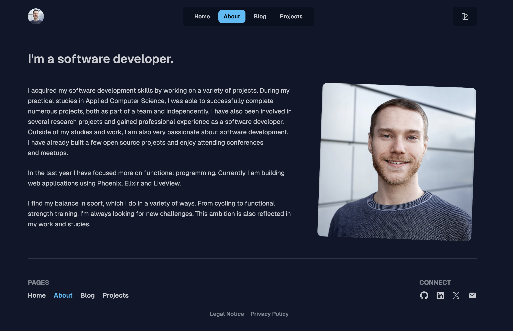

<div align="center">
  
</div>

<h3 align="center">My website and blog built with Phoenix and Elixir.</h3>

<div align="center">
  <a href="https://farens.me/"><strong>Go to website →</strong></a>
  <br />
  <br />
  <a href="https://x.com/flo_arens">x.com</a>
  •
  <a href="mailto:info@farens.me">E-mail</a>
  •
  <a href="https://linkedin.com/in/florian-arens">LinkedIn</a>
</div>

## About

This is the source code for my personal website and blog. It is built using the Phoenix Framework and Elixir. I built it mainly for learning purposes, to use as a digital playground. I use the blog to document my learning journey and to share my thoughts and ideas. Have a look around and let me know if you find any bugs or have any suggestions for improvement.

## Technologies

- **Framework**: [Phoenix Framework](https://phoenixframework.org/)
- **Styling**: [Tailwind CSS](https://tailwindcss.com/) and [daisyUI](https://daisyui.com/)

## Development

Install the versions of Elixir, Erlang, and Bun listed in `.tool-versions`
(for example, with `mise install`). Bun manages JavaScript dependencies and scripts;
Bun also runs the PhoenixTest.Playwright JavaScript driver.

To start your Phoenix server:

* Run `mix setup` to install and setup dependencies
* Start Phoenix endpoint with `mix phx.server` or inside IEx with `iex -S mix phx.server`

JavaScript dependencies are installed from `assets/bun.lock` by `mix setup`
and `mix assets.setup`. To add a dependency, run `bun add <package>` from `assets/`.
Run JavaScript linting with `cd assets && bun run --bun lint:standard`.

Now you can visit [`localhost:4000`](http://localhost:4000) from your browser.

### Tests and checks

Run Mix checks through Bun so Playwright's `node` shebang resolves to Bun:

```sh
bun run --bun mix precommit
bun run --bun mix test --warnings-as-errors
```

Install Chromium and run browser tests:

```sh
(cd assets && bun run --bun playwright install chromium --with-deps --only-shell)
bun run --bun mix test --warnings-as-errors --only playwright
```

To retry failed browser tests with tracing:

```sh
PLAYWRIGHT_TRACE=true bun run --bun mix test --only playwright --max-cases 1 --failed
```

The `--bun` flag supplies a temporary `node` shim for child processes; a separate
Node.js installation is not required. Use this prefix for tests and `mix precommit`,
which starts the Playwright supervisor even when browser tests are excluded.

Ready to run in production? Please [check our deployment guides](https://hexdocs.pm/phoenix/deployment.html).

## Learn more about Phoenix

* Official website: https://www.phoenixframework.org/
* Guides: https://hexdocs.pm/phoenix/overview.html
* Docs: https://hexdocs.pm/phoenix
* Forum: https://elixirforum.com/c/phoenix-forum
* Source: https://github.com/phoenixframework/phoenix
